<div align="center">

# SIMASUK

### Buku agenda dan disposisi surat masuk digital

**BKPSDM Kabupaten Hulu Sungai Selatan**

Catat surat dalam hitungan menit, terbitkan nomor agenda otomatis, lacak disposisi pimpinan sampai tuntas.
Pelengkap SRIKANDI untuk surat fisik dan surat dari luar jaringan SRIKANDI.

<br>

[](docs/09_STACK.md)
[](docs/07_DATA_MODEL.md)
[](docs/26_UI_CONVENTIONS.md)
[](docs/13_TESTING.md)

[](docs/09_STACK.md)
[](composer.json)
[](docs/09_STACK.md)
[](docs/26_UI_CONVENTIONS.md)
[](docs/03_ROADMAP.md)
[](#lisensi)

<br>

[Fitur](#fitur-unggulan) ·
[Tangkapan layar](#tangkapan-layar) ·
[Cara kerja](#cara-kerja) ·
[Mulai cepat](#mulai-cepat) ·
[Keamanan](#keamanan-dan-keandalan) ·
[Roadmap](#roadmap) ·
[Dokumentasi](#dokumentasi)

<br>

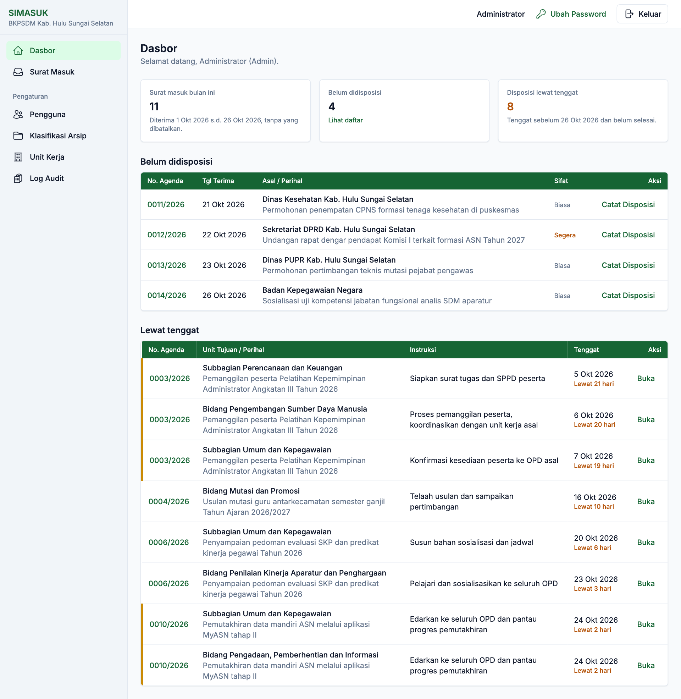

<sub>Dasbor: surat bulan ini, surat yang menunggu disposisi, dan disposisi yang lewat tenggat dalam satu layar.</sub>

</div>

---

## Kenapa SIMASUK?

Di banyak kantor, surat masuk masih dicatat di buku agenda kertas. Lembar disposisi pimpinan tersimpan terpisah dari suratnya. Akibatnya:

- surat lama sulit ditemukan saat pimpinan menanyakannya,
- posisi tindak lanjut tidak terlihat, sudah sampai bidang mana dan siapa yang memegang,
- tenggat disposisi mudah terlewat tanpa ada yang menyadari.

SRIKANDI hanya menampung naskah yang memang dikirim lewat SRIKANDI. Surat fisik dan surat dari instansi di luar jaringan SRIKANDI tetap tercecer.

**SIMASUK menutup celah itu.** Operator TU mencatat setiap surat dan mengunggah scan PDF-nya, lalu nomor agenda terbit otomatis. Disposisi berjenjang dari lembar pimpinan diinput ke aplikasi, sehingga setiap surat bisa ditelusuri sampai disposisi terakhirnya dari satu halaman. Untuk surat yang juga ada di SRIKANDI, nomor SRIKANDI-nya disimpan sebagai rujukan.

| Target | Ukuran keberhasilan |
|---|---|
| Kelengkapan | 100% surat masuk tercatat dengan nomor agenda unik per tahun |
| Kecepatan | Satu surat tercatat lengkap (metadata + PDF) dalam 3 menit atau kurang |
| Keterlacakan | Setiap surat tertelusur ke disposisi terakhirnya dalam satu halaman detail |
| Performa | Halaman daftar dimuat dalam 1 detik untuk 10.000 surat |

---

## Fitur unggulan

### Agenda surat masuk

- **Nomor agenda otomatis dan unik per tahun.** Nomor diambil dari penghitung khusus di dalam satu transaksi. Kalau penyimpanan gagal, nomor tidak terpakai dan tidak ada lompatan nomor.
- **Unggah scan PDF**, 1 sampai 5 berkas per surat, maksimal 10 MB per berkas. Isi berkas divalidasi, tidak cukup dari ekstensinya saja.
- **Deteksi surat ganda.** Muncul peringatan bila nomor, asal, dan tanggal surat sama dengan surat yang sudah tercatat.
- **Pencarian dan filter**: nomor agenda, nomor surat, asal, perihal, tahun, status, sifat, dan rentang tanggal terima.
- **Sifat surat**: Biasa, Segera, Sangat Segera (diberi penanda garis kuning), dan Rahasia (diberi badge merah).
- **Rujukan SRIKANDI** opsional di setiap surat.

### Disposisi berjenjang

- **Satu disposisi ke banyak unit sekaligus.** Setiap unit tujuan mendapat baris disposisi sendiri dengan statusnya masing-masing.
- **Disposisi lanjutan**, misalnya dari Kabid ke Kasubbag, ditampilkan sebagai **pohon riwayat** yang berindentasi per jenjang.
- **Tenggat per disposisi**. Disposisi yang lewat tenggat otomatis naik ke dasbor.
- **Tandai selesai** per disposisi dengan catatan tindak lanjut, atau tutup surat sekaligus. Disposisi yang masih terbuka ikut ditutup dengan catatan otomatis.

### Dasbor dan pengawasan

- **Tiga angka kunci**: surat bulan ini, surat belum didisposisi, dan disposisi lewat tenggat.
- **Daftar kerja**: surat yang paling lama menunggu disposisi tampil paling atas, dan disposisi yang lewat tenggat disertai keterangan "lewat N hari".
- **Log audit**: setiap perubahan data tercatat lengkap dengan pelaku, waktu, IP, serta data sebelum dan sesudah. Log tidak bisa diubah atau dihapus.

### Pengaturan (Admin)

- **Kelola pengguna**: buat akun, nonaktifkan, dan reset password. Admin aktif terakhir tidak bisa dinonaktifkan.
- **Master kode klasifikasi arsip** dan **unit kerja berhierarki** sesuai SOTK. Data master dinonaktifkan, tidak pernah dihapus.

---

## Tangkapan layar

> Semua tangkapan layar memakai data demo fiktif.

<table>
  <tr>
    <td width="50%" valign="top">
      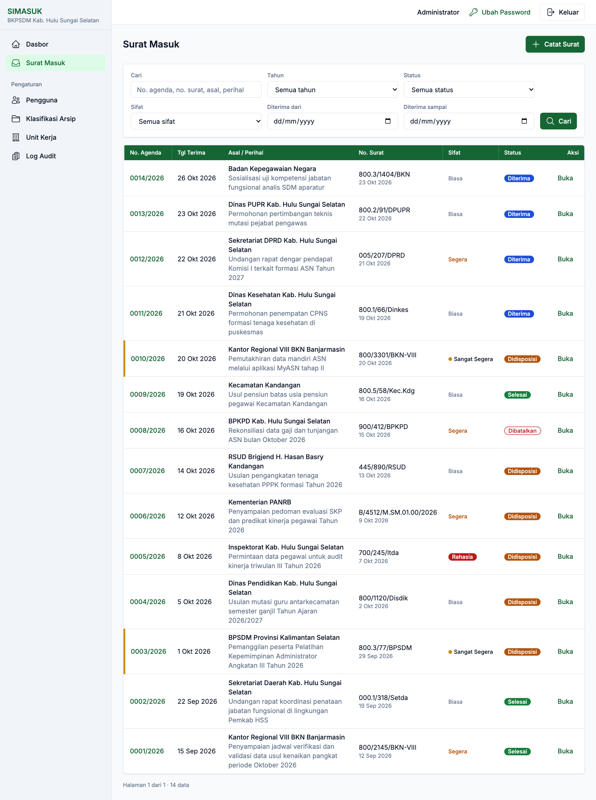
      <p align="center"><b>Daftar surat masuk</b><br><sub>Filter lengkap, badge status, dan penanda sifat surat</sub></p>
    </td>
    <td width="50%" valign="top">
      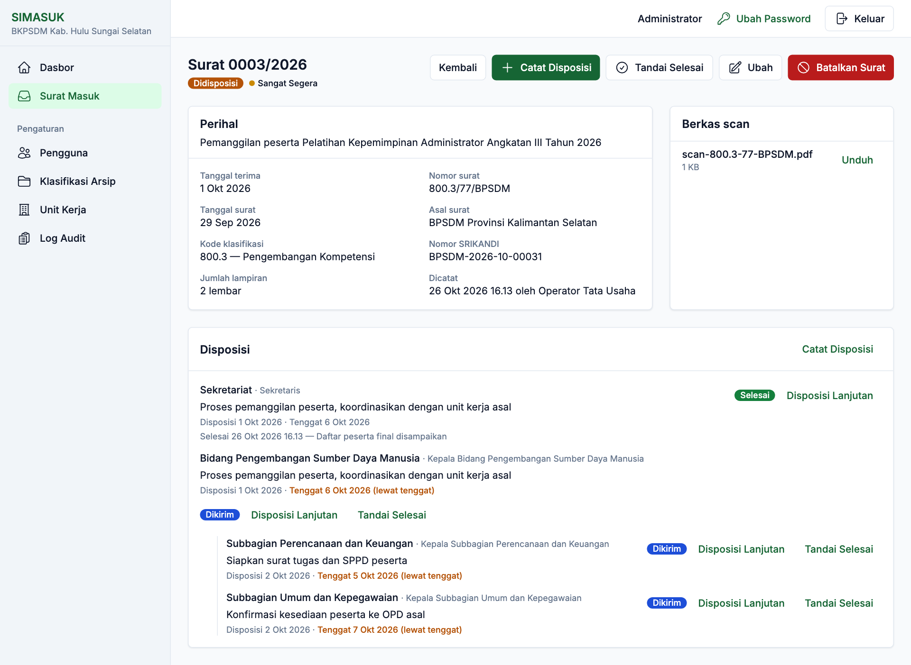
      <p align="center"><b>Detail surat dan pohon disposisi</b><br><sub>Metadata, berkas scan, dan riwayat disposisi berjenjang</sub></p>
    </td>
  </tr>
  <tr>
    <td width="50%" valign="top">
      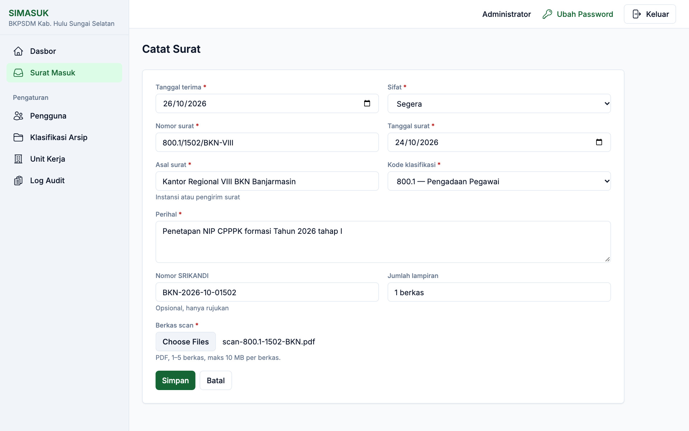
      <p align="center"><b>Catat surat</b><br><sub>Satu formulir ringkas, nomor agenda terbit saat disimpan</sub></p>
    </td>
    <td width="50%" valign="top">
      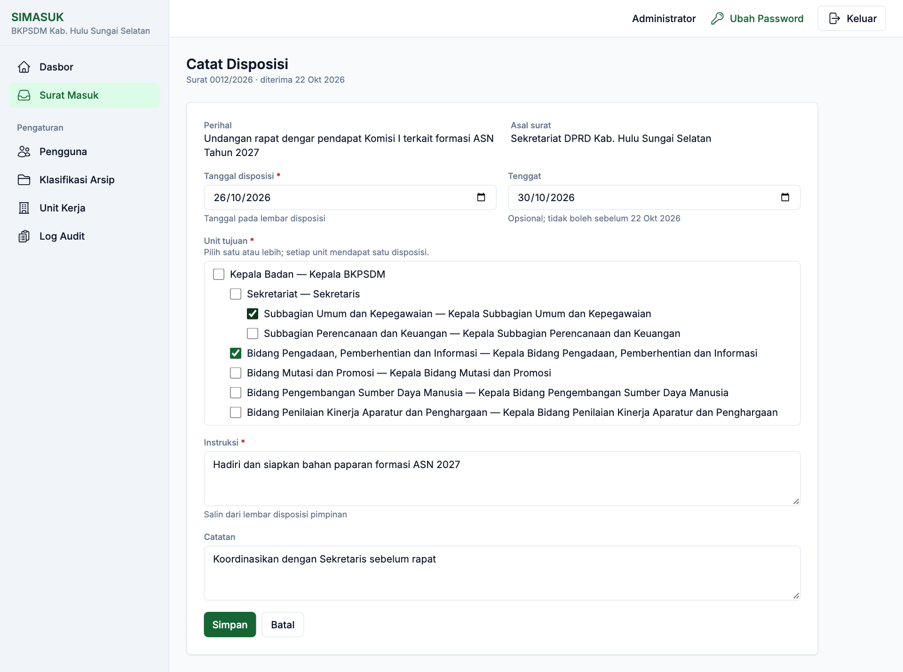
      <p align="center"><b>Catat disposisi</b><br><sub>Pilih beberapa unit tujuan sekaligus dari struktur organisasi</sub></p>
    </td>
  </tr>
  <tr>
    <td width="50%" valign="top">
      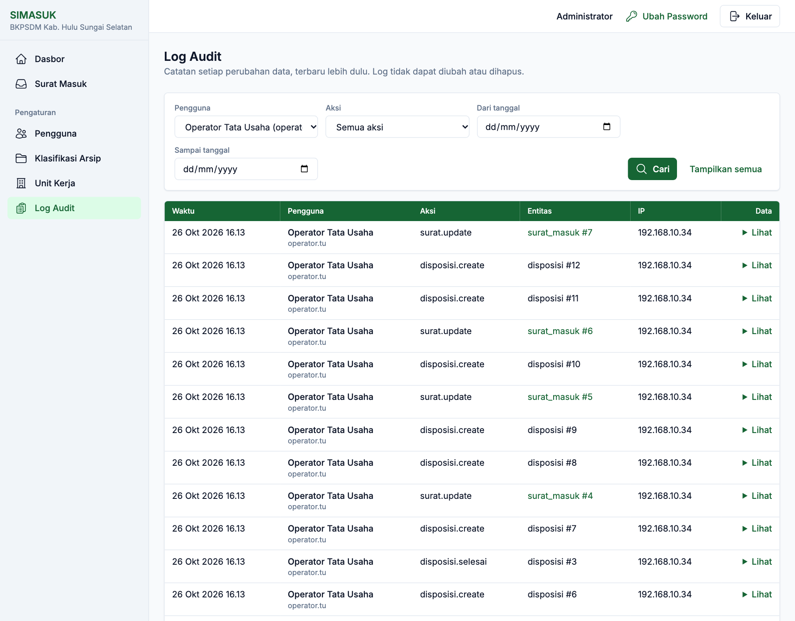
      <p align="center"><b>Log audit</b><br><sub>Siapa mengubah apa, kapan, dan dari IP mana</sub></p>
    </td>
    <td width="50%" valign="top">
      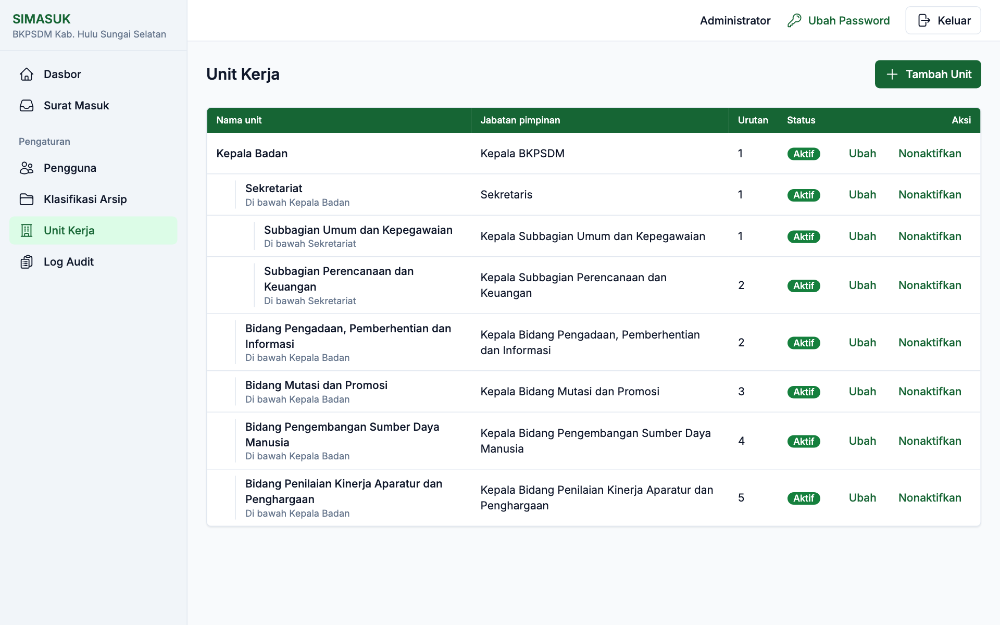
      <p align="center"><b>Unit kerja berhierarki</b><br><sub>Struktur organisasi sebagai sumber tujuan disposisi</sub></p>
    </td>
  </tr>
  <tr>
    <td width="50%" valign="top">
      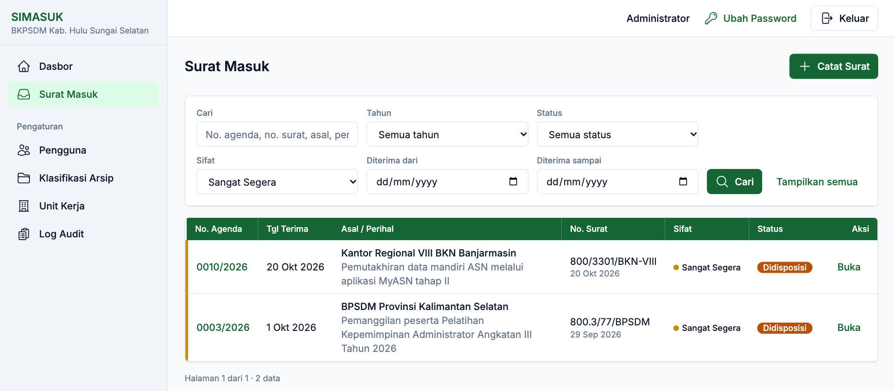
      <p align="center"><b>Filter cepat</b><br><sub>Contoh: semua surat bersifat Sangat Segera</sub></p>
    </td>
    <td width="50%" valign="top">
      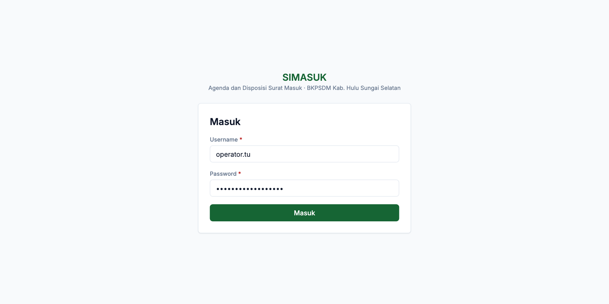
      <p align="center"><b>Halaman masuk</b><br><sub>Login username dan password dengan penguncian otomatis</sub></p>
    </td>
  </tr>
</table>

<details>
<summary><b>Tampilan tablet (lebar 768 px)</b></summary>
<br>
<p align="center">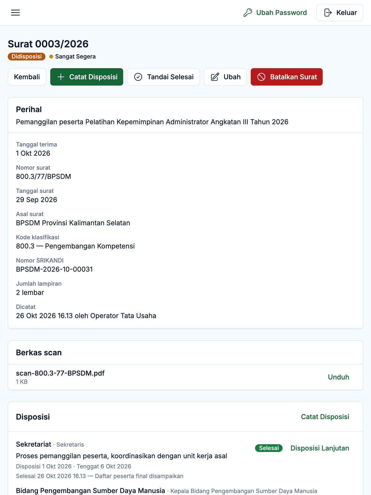</p>
<p align="center"><sub>Di bawah 1024 px, sidebar menjadi laci dan tabel bergulir di dalam kartunya. Halaman tidak pernah bergulir ke samping.</sub></p>
</details>

---

## Cara kerja

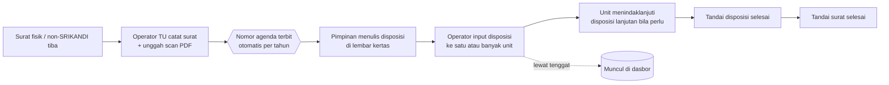

Status surat bergerak satu arah: **Diterima** → **Didisposisi** → **Selesai**. Admin bisa **Membatalkan** surat dengan alasan wajib, dan surat tetap tersimpan. Tidak ada data bisnis yang dihapus permanen.

### Peran

| Kapabilitas | Admin | Operator TU |
|---|:---:|:---:|
| Lihat dasbor, daftar, dan detail surat (termasuk Rahasia), unduh PDF | ✓ | ✓ |
| Catat dan ubah surat, unggah berkas | ✓ | ✓ |
| Catat disposisi, tandai disposisi dan surat selesai | ✓ | ✓ |
| Batalkan surat (alasan wajib) | ✓ | – |
| Kelola pengguna, klasifikasi arsip, dan unit kerja | ✓ | – |
| Lihat log audit | ✓ | – |
| Ubah nomor agenda atau hapus permanen data apa pun | – | – |

Matriks lengkap ada di [docs/05_USER_ROLE.md](docs/05_USER_ROLE.md). Pimpinan belum memiliki akun pada MVP. Disposisinya diinput oleh Operator dari lembar kertas.

---

## Teknologi

SIMASUK sengaja dibangun **ramping dan mandiri**, agar mudah dirawat tim TI pemda dan tetap berjalan di server tanpa akses internet keluar.

| Lapisan | Pilihan |
|---|---|
| Bahasa | PHP 8.3, native modular **tanpa framework** |
| Basis data | MySQL 8.0 (InnoDB, utf8mb4), akses lewat PDO prepared statement di lapisan Repository |
| Antarmuka | Tailwind CSS v4 (Standalone CLI, tanpa Node di server), font Inter dan ikon Heroicons disimpan lokal |
| JavaScript | Vanilla JS, satu berkas (`public/assets/app.js`) |
| Tes | PHPUnit 11, unit dan integrasi dengan basis data sungguhan |
| Server | Nginx + PHP-FPM di Ubuntu 24.04 |

**Dependensi Composer runtime: nol.** Satu-satunya dependensi dev adalah PHPUnit. Detail dan daftar teknologi yang sengaja tidak dipakai ada di [docs/09_STACK.md](docs/09_STACK.md).

### Arsitektur singkat

```text
public/index.php → Router → Middleware (auth, role, CSRF) → modules/<Domain>/
                                                              ├── Controller   tipis, hanya HTTP
                                                              ├── Service      aturan bisnis + transaksi
                                                              ├── Repository   satu-satunya tempat SQL
                                                              └── views        PHP template + Tailwind
```

```text
simasuk/
├── app/Core/           Router, Request/Response, Database, Validator, FileStore, Audit, Session
├── app/Middleware/     Auth, Guest, Role, Csrf
├── modules/            Agenda · Disposisi · Dasbor · Audit · Auth · Master · Pengguna
├── config/             app.php, routes.php (setiap rute wajib bermiddleware)
├── migrations/         SQL maju-saja, bernomor
├── resources/          css/app.css (token desain) · views/ (layout + komponen)
├── scripts/            migrate.php · seed.php · validate.sh
├── tests/              Unit/ · Integration/
└── docs/               Blueprint 00–26 + screenshots/
```

Lihat [docs/08_ARCHITECTURE.md](docs/08_ARCHITECTURE.md) untuk alur request dan keputusan arsitektur.

---

## Mulai cepat

### Prasyarat

- PHP 8.3 CLI dengan ekstensi `pdo_mysql`, `fileinfo`, `mbstring`, `sodium`
- Composer 2
- MySQL 8.0
- *(Opsional, hanya bila mengubah tampilan)* binary [Tailwind CSS v4 Standalone](https://github.com/tailwindlabs/tailwindcss/releases) di `bin/tailwindcss`

### Instalasi

```bash
# 1. Pasang dependensi
composer install

# 2. Siapkan konfigurasi
cp .env.example .env
php -r 'echo base64_encode(random_bytes(32)), PHP_EOL;'   # tempel hasilnya ke APP_KEY
#    isi DB_*, STORAGE_PATH & LOG_PATH (path absolut, di luar public/),
#    serta SEED_ADMIN_USERNAME & SEED_ADMIN_PASSWORD (minimal 10 karakter)

# 3. Buat basis data utama dan basis data uji
mysql -u root -p -e "CREATE DATABASE simasuk CHARACTER SET utf8mb4 COLLATE utf8mb4_unicode_ci;
                     CREATE DATABASE simasuk_test CHARACTER SET utf8mb4 COLLATE utf8mb4_unicode_ci;"

# 4. Migrasi dan seeder awal (membuat akun admin + contoh unit kerja)
php scripts/migrate.php
php scripts/seed.php

# 5. Jalankan
php -S localhost:8000 -t public
```

Buka **<http://localhost:8000>** dan masuk memakai akun admin dari `.env`. Langkah berikutnya: isi **Klasifikasi Arsip**, sesuaikan **Unit Kerja** dengan SOTK, lalu buat akun **Operator TU**.

### Perintah harian

| Tujuan | Perintah |
|---|---|
| Server dev | `php -S localhost:8000 -t public` |
| Semua tes | `vendor/bin/phpunit` |
| Siapkan DB uji | `php scripts/migrate.php --env=testing` |
| Status migrasi | `php scripts/migrate.php --status` |
| Build CSS (sekali) | `./bin/tailwindcss -i resources/css/app.css -o public/assets/app.css --minify` |
| Build CSS (pantau) | `./bin/tailwindcss -i resources/css/app.css -o public/assets/app.css --watch` |
| Cek konsistensi blueprint | `bash scripts/validate.sh` |

Daftar lengkap ada di [docs/11_COMMANDS.md](docs/11_COMMANDS.md). Untuk produksi (Nginx, PHP-FPM, HTTPS), lihat [docs/10_DEV_ENV.md](docs/10_DEV_ENV.md) dan ikuti urutan [docs/25_RELEASE_CHECKLIST.md](docs/25_RELEASE_CHECKLIST.md).

---

## Keamanan dan keandalan

Tanpa framework, keamanan ditegakkan secara eksplisit di setiap lapisan:

- **Password Argon2id**, dengan penguncian 15 menit setelah 5 kali gagal login. Pesan galat dibuat umum agar tidak membocorkan username.
- **Sesi aman**: ID sesi diregenerasi saat login, cookie `HttpOnly` + `SameSite=Lax`, timeout menganggur 60 menit.
- **CSRF** di setiap POST. Tidak ada perubahan data lewat GET.
- **SQL injection** dicegah dengan PDO prepared statement (emulasi dimatikan), dan SQL hanya ditulis di Repository.
- **XSS** dicegah karena seluruh output melewati `e()`. CSP ketat tanpa inline script, ditambah header `nosniff` dan `X-Frame-Options: DENY`.
- **Berkas di luar `public/`** dengan nama acak. Isinya divalidasi sebagai PDF asli (MIME + signature), dan berkas hanya bisa diunduh lewat rute yang terautentikasi.
- **Tanpa hapus permanen**. Surat dibatalkan dan data master dinonaktifkan, tidak dihapus, sehingga jejaknya tetap utuh.
- **Log audit** untuk setiap perubahan data.

Aturan lengkap ada di [docs/21_SECURITY_RULES.md](docs/21_SECURITY_RULES.md).

### Pengujian

```text
OK (159 tests, 743 assertions)
```

Tes integrasi berjalan di basis data MySQL sungguhan (`DB_TEST_NAME`) dan menguji hal-hal yang paling berisiko: penomoran agenda, transaksi unggah berkas, aturan status disposisi, otorisasi per peran, dan migrasi. Strategi pengujian ada di [docs/13_TESTING.md](docs/13_TESTING.md).

---

## Roadmap

| Fase | Cakupan | Status |
|---|---|---|
| **F1 Fondasi** | Kerangka native, login, kelola pengguna, master klasifikasi dan unit, pencatatan audit | Selesai |
| **F2 Agenda** | Catat surat, nomor agenda otomatis, unggah PDF, cari, unduh, batal | Gerbang mesin lulus, menunggu uji manual |
| **F3 Disposisi** | Disposisi berjenjang, pohon riwayat, tandai selesai | Gerbang mesin lulus, menunggu uji manual |
| **F4 Dasbor** | Dasbor ringkas, halaman log audit, pencarian lanjut | Dalam pengerjaan |
| **Pasca-MVP** | Cetak lembar disposisi PDF, notifikasi, rekap bulanan xlsx, peran Pimpinan | Direncanakan |

Sengaja **di luar cakupan** MVP: surat keluar, integrasi API SRIKANDI, TTE, OCR, multi-OPD, dan aplikasi mobile. Alasannya ada di [docs/02_SCOPE.md](docs/02_SCOPE.md).

---

## Dokumentasi

SIMASUK dibangun dari **paket blueprint bernomor** (`docs/00` sampai `docs/26`) yang menjadi sumber kebenaran untuk pengembang maupun AI coding assistant.

| Mulai dari | Isi |
|---|---|
| [INDEX.md](INDEX.md) | Peta dokumen: jenis tugas dan dokumen yang perlu dibaca |
| [docs/00_EXECUTIVE_SUMMARY.md](docs/00_EXECUTIVE_SUMMARY.md) | Masalah, solusi, dan metrik keberhasilan |
| [docs/01_PRD.md](docs/01_PRD.md) | Daftar fitur dan user story |
| [docs/07_DATA_MODEL.md](docs/07_DATA_MODEL.md) | Skema basis data |
| [docs/26_UI_CONVENTIONS.md](docs/26_UI_CONVENTIONS.md) | Token desain dan inventaris komponen antarmuka |
| [CLAUDE.md](CLAUDE.md) | Aturan inti untuk AI coding assistant |

---

## Lisensi

Proprietary. Hak cipta pada **BKPSDM Kabupaten Hulu Sungai Selatan**. Kode ini tidak untuk didistribusikan ulang tanpa izin tertulis.

Font Inter disertakan di bawah SIL Open Font License ([public/assets/fonts/Inter-LICENSE.txt](public/assets/fonts/Inter-LICENSE.txt)). Ikon Heroicons berlisensi MIT.

<div align="center">
<br>
<sub>Dibuat untuk tata usaha yang lebih tertib di Kabupaten Hulu Sungai Selatan.</sub>
</div>
